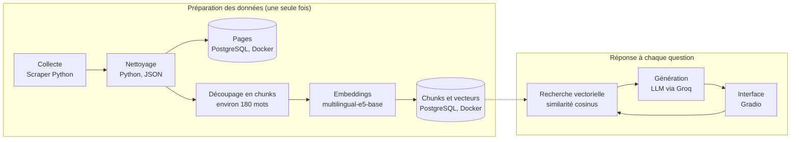

# Assistant SUPMTI Oujda

Assistant virtuel qui répond aux questions sur l'école SUPMTI Oujda (formations, admission, débouchés, certifications) à partir des pages de son site officiel.

Le projet repose sur la technique du **RAG** (Retrieval-Augmented Generation) : les réponses ne viennent pas de la mémoire du modèle, mais de passages du site retrouvés par recherche vectorielle, puis reformulés par un modèle de langage. Chaque réponse est accompagnée des pages sources.

## Fonctionnalités

- Collecte et nettoyage automatiques des pages du site de l'école
- Stockage des pages et des vecteurs dans PostgreSQL, exécuté dans un conteneur Docker
- Recherche sémantique multilingue (français, arabe) grâce à un modèle d'embeddings
- Génération de réponses appuyées uniquement sur le contexte retrouvé, avec les liens sources
- Interface de discussion web (Gradio)

## Architecture



**Phase 1, préparation des données.** Les pages du site sont collectées, nettoyées, puis découpées en chunks (morceaux d'environ 180 mots). Chaque chunk est transformé en vecteur de 768 nombres par le modèle `intfloat/multilingual-e5-base`. Pages et vecteurs sont enregistrés dans PostgreSQL.

**Phase 2, réponse à une question.** La question de l'utilisateur est transformée en vecteur avec le même modèle, puis comparée aux vecteurs des chunks par similarité cosinus. Les chunks les plus proches sont envoyés au modèle de langage avec la question. Le modèle rédige la réponse en s'appuyant uniquement sur ce contexte, et l'interface affiche les sources.

## Technologies

| Rôle | Technologie |
|---|---|
| Langage | Python 3.12 |
| Collecte et nettoyage | Scraper Python, fichiers JSON |
| Base de données | PostgreSQL 16 |
| Conteneurisation | Docker et Docker Compose |
| Accès à la base | SQLAlchemy |
| Embeddings | sentence-transformers, modèle `intfloat/multilingual-e5-base` (768 dimensions) |
| Recherche vectorielle | numpy (similarité cosinus) |
| Modèle de langage | API Groq (nom du modèle configurable) |
| Interface | Gradio |

## Structure du projet

```
supmti-assistant/
├── scraper/            Collecte des pages du site
├── cleaning/           Nettoyage et préparation des textes
├── database/           Modèles SQLAlchemy (tables pages et chunks)
├── embeddings/         Découpage, calcul des embeddings, import dans PostgreSQL
│   ├── calculer_embeddings.py
│   └── importer_chunks.py
├── chatbot/
│   └── rag.py          Recherche, génération et interface Gradio
├── data/
│   ├── raw/            Données brutes collectées
│   └── processed/      Pages nettoyées, chunks et vecteurs
├── docker-compose.yml  Base PostgreSQL
├── .env.example        Modèle du fichier de configuration
└── README.md
```

## Installation

### Prérequis

- Python 3.12
- Docker Desktop
- Une clé API Groq (offre gratuite disponible, avec limites de débit)

### Mise en place

```powershell
git clone https://github.com/MsMehdad/supmti-assistant.git
cd supmti-assistant

python -m venv .venv
.venv\Scripts\Activate.ps1

pip install -r embeddings/requirements.txt
pip install groq gradio python-dotenv
```

### Configuration

Copiez le fichier d'exemple, puis complétez-le :

```powershell
Copy-Item .env.example .env
```

Variables du fichier `.env` :

| Variable | Description |
|---|---|
| `POSTGRES_USER` | Utilisateur de la base |
| `POSTGRES_PASSWORD` | Mot de passe de la base (à changer) |
| `POSTGRES_DB` | Nom de la base |
| `POSTGRES_PORT` | Port local de la base (5433 par défaut) |
| `GROQ_API_KEY` | Clé API Groq |
| `GROQ_MODEL` | Modèle utilisé (optionnel, `openai/gpt-oss-120b` par défaut) |

Le fichier `.env` est ignoré par Git : ne le publiez jamais.

## Utilisation

**1. Démarrer la base de données**

```powershell
docker compose up -d
docker compose ps
```

Le conteneur `supmti-db` doit apparaître avec l'état `healthy`. Les données sont conservées dans un volume Docker, même après l'arrêt du conteneur.

**2. Collecter et nettoyer les pages, puis les charger en base**

```powershell
python scraper/<script_de_collecte>.py
python cleaning/<script_de_nettoyage>.py
python database/<script_de_chargement_des_pages>.py
```

**3. Calculer les embeddings**

```powershell
python embeddings/calculer_embeddings.py
```

Le premier lancement télécharge le modèle (environ 1 Go). Le calcul peut aussi être fait sur Google Colab avec l'option `--entree` et `--sortie`, puis le fichier `chunks_embeddings.json` est placé dans `data/processed/`.

**4. Importer les chunks dans PostgreSQL**

```powershell
python embeddings/importer_chunks.py
```

Le script contrôle le fichier avant l'import, puis affiche le nombre de chunks, le modèle, les dimensions et la norme des vecteurs.

**5. Lancer l'assistant**

```powershell
python chatbot/rag.py
```

L'interface est disponible sur `http://127.0.0.1:7860`. Il est aussi possible de poser une question directement dans le terminal :

```powershell
python chatbot/rag.py "Quelles certifications Cisco sont proposées ?"
```

## Mettre à jour les données

Le projet n'entraîne aucun modèle : seules les données changent. Quand le site de l'école évolue, il suffit de rejouer les étapes 2 à 4, puis de relancer l'assistant, qui charge les vecteurs au démarrage.

## Choix techniques

- **RAG plutôt que réentraînement.** Mettre à jour les connaissances revient à mettre à jour la base de données, sans coût de calcul d'entraînement. Les réponses sont traçables grâce aux sources.
- **Même modèle pour documents et questions.** Les vecteurs ne sont comparables que s'ils viennent du même modèle. Le modèle e5 impose aussi des préfixes (`passage:` pour les documents, `query:` pour les questions), appliqués dans le code.
- **Recherche avec numpy plutôt qu'une extension vectorielle.** Avec quelques dizaines de chunks, une comparaison directe en mémoire est rapide et garde la base simple (PostgreSQL standard).
- **Docker pour la base.** L'environnement est reproductible : une commande suffit, sans installer PostgreSQL sur la machine. Le conteneur est limité à 512 Mo de mémoire et n'est accessible que depuis la machine locale.
- **Consigne de prudence pour le modèle de langage.** Le modèle doit répondre uniquement à partir du contexte et indiquer qu'il ne sait pas quand l'information est absente.

## Limites et pistes d'amélioration

- Évaluer la qualité de la recherche avec un jeu de questions de test
- Script unique de mise à jour automatique des données, avec contrôle de sécurité
- Mise à jour incrémentale à partir du hash du contenu de chaque page
- Système de recommandation de filières
- Conteneurisation du chatbot dans Docker Compose

## Auteure

Projet réalisé par Mehdad, étudiante en ingénierie Data Science et Cloud Computing.